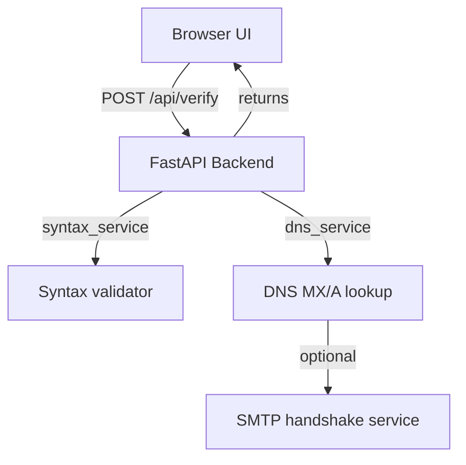

# MailCheck – Bulk Email Verification Tool

## Overview
MailCheck is a production‑ready web application that lets users paste a list of email addresses, validates them, and classifies each address as **Likely Delivered**, **Likely to Bounce**, or **Unknown**. The classification is based on layered checks:
1. **Syntax validation** (RFC 5322 compliance).
2. **Domain validation** – DNS MX lookup (or fallback A/AAAA records).
3. **SMTP verification** – a conservative handshake (optional, may be blocked on many cloud hosts).

The app is honest about its limitations: it never guarantees delivery and clearly labels uncertain cases as **Unknown**.

---

## Feature List
- Large textarea for bulk input (comma/semicolon/space/newline separated).  
- Duplicate detection with deduplication reporting.  
- Real‑time progress indicator.  
- Summary cards showing total checked, delivered, bounce, unknown.  
- Filterable / sortable results table with status badges (green/red/amber).  
- Copy‑to‑clipboard per‑email and CSV/JSON export.  
- Responsive, accessible UI built with React, Vite, Tailwind CSS, Lucide icons.  
- FastAPI backend with async services, environment‑driven configuration, and privacy‑preserving logging.  
- Comprehensive unit and integration tests (pytest).  
- Dockerfile and Render deployment configuration.

---

## Technology Stack
| Layer | Tech |
|-------|------|
| **Frontend** | React 18 + Vite, Tailwind CSS, Lucide React icons |
| **Backend** | Python 3.11, FastAPI, uvicorn, email‑validator, dnspython, httpx |
| **Testing** | pytest, pytest‑asyncio, unittest.mock |
| **Containerisation** | Docker |
| **Deployment** | Render (free tier) – Docker for backend, static‑site service for frontend |
| **Version control** | Git + GitHub |

---

## Architecture & Request Flow

1. User clicks **Verify Emails** → frontend sends `POST /api/verify` with JSON `{ "emails": ["a@b.com", …] }`.
2. Backend deduplicates, runs the three checks concurrently (limited concurrency).
3. Each address gets an `EmailVerificationResult` containing detailed sub‑check results, a human‑readable `explanation`, and a machine‑readable `reason_code`.
4. The response also includes a `VerifySummary` with aggregated counts.
5. Frontend renders the table, summary cards, and offers export.

---

## Installation & Local Development
### Prerequisites
- **Python 3.11+** (recommended via `pyenv` or the official installer)
- **Node 20+** and **npm**
- **Git**

### Backend
```bash
cd backend
python -m venv .venv
. .venv/Scripts/activate   # PowerShell: .\.venv\Scripts\Activate.ps1
pip install -r requirements.txt
# Run locally (auto‑reload)
uvicorn app.main:app --reload --host 127.0.0.1 --port 8000
```
- Health check: `curl http://127.0.0.1:8000/health`
- Run tests: `pytest`

### Frontend
```bash
cd ../frontend
npm install
# Development server (proxy to backend on localhost)
npm run dev   # VITE_API_URL defaults to http://127.0.0.1:8000
```
Open <http://localhost:5173> in a browser.

### Production Build
```bash
npm run build   # outputs to ./dist
```
The built `dist/` folder can be served as static files (Render static‑site service).

---

## Docker & Render Deployment
### Backend Dockerfile (already in `backend/Dockerfile`)
```Dockerfile
FROM python:3.11-slim
WORKDIR /app
COPY backend/requirements.txt ./
RUN pip install -r requirements.txt --no-cache-dir
COPY backend/ .
EXPOSE $PORT
ENV PORT=8000
CMD ["uvicorn", "app.main:app", "--host", "0.0.0.0", "--port", "${PORT}" ]
```
### Render `render.yaml`
```yaml
services:
  - type: web
    name: mailcheck-backend
    env: docker
    dockerfilePath: backend/Dockerfile
    healthCheckPath: /health
    plan: free

  - type: static
    name: mailcheck-frontend
    buildCommand: npm install && npm run build
    staticPublishPath: frontend/dist
    envVars:
      - key: VITE_API_URL
        value: https://mailcheck-backend.onrender.com   # replace with your backend URL
    plan: free
```
**Important:** Render blocks outbound port 25, so the backend will mark `smtp.attempted` as `false` and set status to **Unknown** for SMTP‑dependent cases. The API response includes `smtp_enabled` flag, and the UI displays a short notice about this limitation.

---

## Privacy & Security Considerations
- No email addresses are persisted – all processing is in‑memory.
- Logs mask email addresses (only the domain, if needed, is logged).
- No API secrets are exposed to the frontend; only the public API URL is configured via `VITE_API_URL`.
- CORS is restricted to the configured frontend origin.
- Rate‑limits and request‑size caps (`max 500 emails per request`) are enforced.
- SMTP verification can be disabled via the `SMTP_ENABLED=false` environment variable.

---

## Known Limitations
- **SMTP checks may be blocked** on many cloud providers (including Render). When blocked, the backend reports `smtp.attempted: false` and classifies the address as **Unknown**.
- The service does **not** send any email; it only performs handshakes.
- Results are probabilistic; the UI clearly states that a "Likely Delivered" label is not a delivery guarantee.

---

## License
MIT – feel free to fork, modify, and deploy.

---

## Author
MEDA SAI SNEHA SREE

---

*End of README*
